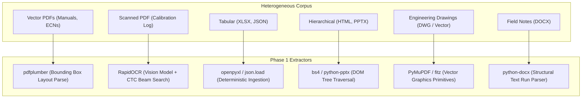
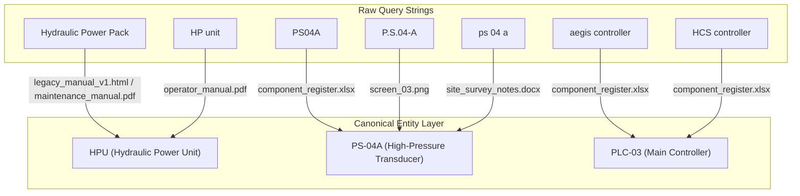
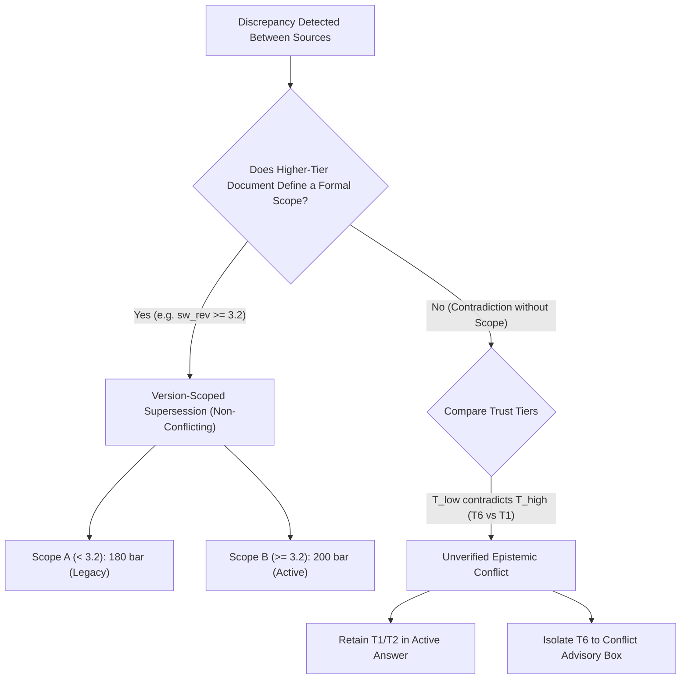

# Aegis Series-7 Hydraulic Control System (HCS)
# Comprehensive Theory & Architecture Deep-Dive

**Document Purpose**: Definitive Theoretical Reference & Phase-by-Phase Technical Guide  
**Subject**: Deterministic Industrial Knowledge Systems, Epistemic Graphs, and Claim Retrieval  
**Scope**: All Phases (Phase 1 Ingestion through Phase 7 Evaluation & Hardening)  

---

## 1. Foundational Philosophy: Why Deterministic Claim-Based Retrieval?

### 1.1 The Failure Mode of Generative LLMs in Mission-Critical Engineering
In mission-critical industrial systems (such as high-pressure hydraulic skids operating at 200 bar), probabilistic generative models (such as conventional RAG using vector cosine similarity and autoregressive text generation) present catastrophic safety risks:

1. **Stochastic Paraphrasing & Numeric Drift**: A generative language model asked for a pressure setpoint might generate "approximately 200 bar" or interpolate between historical 180 bar and active 200 bar specs without guaranteeing citation adherence.
2. **Hallucination of Plausible Connectivity**: When analyzing schematics or wiring schedules, LLMs frequently invent plausible connections (e.g., claiming a direct terminal link between a controller and an actuator simply because their names co-occur in the same paragraph).
3. **Temporal Inversion & Flawed Version Reasoning**: Generative RAG systems embed text chunks independently. When an older document (Rev 1.0) and a newer Engineering Change Notice (ECN) both score high cosine similarity against a query, the generator often blends the conflicting facts or hallucinates an unverified compromise.
4. **Silent Epistemic Overconfidence**: LLMs struggle to know what they *do not know*. When asked about an undocumented component or a false premise (e.g., "What is the operating voltage of hydraulic sensor PS-04?"), an LLM will frequently confabulate a voltage (e.g., "24V DC") rather than abstaining.

### 1.2 The Deterministic Alternative: Typed Claim Epistemology
The Aegis Knowledge Base operates on the principle of **Auditable Epistemic Graphs**:
- **Zero Generative Inference**: At query runtime, no neural model synthesizes ungrounded sentences.
- **Atomic Semantic Claims**: Information is decomposed into verifiable tuples:
  $$\mathcal{C} = \langle \text{Subject}, \text{Predicate}, \text{Value}, \text{VersionScope}, \text{Status}, \text{TrustTier}, \text{EvidenceList} \rangle$$
- **Rule-Based Synthesis**: Answers are constructed by deterministic aggregation of claims matching exact entity-predicate intersections, complete with source provenance and conflict warnings.

---

## 2. Phase 1: Multimodal Ingestion & Data Extraction Theory

Industrial engineering domains do not store knowledge in uniform text files. Knowledge is fragmented across heterogeneous formats, each requiring specialized parsing theory.



### 2.1 Vector PDF Layout Parsing (`pdfplumber`)
- **Theory**: Vector PDFs store text as character placement matrices with explicit coordinate tuples $(x_0, y_0, x_1, y_1)$. Linear raw text extraction destroys tabular structure.
- **Implementation**: Bounding-box layout analysis extracts tabular cells based on explicit line-edge intersections, preserving column alignment across multi-page manuals (`operator_manual.pdf`, `maintenance_manual.pdf`).

### 2.2 Neural Optical Character Recognition & Error Recovery (`RapidOCR`)
- **Theory**: Scanned physical prints (`scanned_appendix_calibration.pdf`) introduce optical noise, skew, variable DPI, and font compression.
- **The CTC Decoding Bottleneck**: Text line recognition uses a Convolutional Neural Network (CNN) backbone with Connectionist Temporal Classification (CTC). In dense engineering tables:
  - Tight inter-word spacing collapses character probability distributions, causing **numeric concatenation** (`"0.1bar"` instead of `"0.1 bar"`).
  - Glyph similarities between numeric zero `0` and uppercase latin `O` produce substitution errors (`"2OObar"`).
- **Post-OCR Normalization Theory**: Rather than relying on fragile manual corrections, the pipeline enforces strict regularized phonetic and lexical grammar filters:
  ```python
  # Concatenation recovery
  text = re.sub(r'(\d+\.?\d*)\s*(bar|Bar|BAR)', r'\1 bar', text)
  # Numeric glyph arbitration
  text = re.sub(r'(\d+)O(\d*)\s*bar', r'\10\2 bar', text)
  # Entity token casing enforcement
  text = re.sub(r'\bHCs\b', 'HCS', text)
  ```

### 2.3 Vector Engineering Drawing Geometry & Topology (`PyMuPDF`)
- **Theory**: Schematics (`system_diagram_hydraulic.pdf`, `wiring_diagram.pdf`) are vector instruction sets containing bezier curves, path strokes, and text glyph placements.
- **Proximity vs. Connectivity Artifacts**:
  In schematic interpretation, two symbols being physically adjacent within a 2D bounding box does *not* imply an electrical or hydraulic connection:
  $$\text{Distance}(B_{\text{component}}, B_{\text{label}}) < \epsilon \quad \not\implies \quad \text{Connected}(C_1, C_2)$$
  By parsing vector line endpoints and cross-referencing against independent wiring diagrams (`wiring_diagram.pdf`), the system formally separates real electrical connections from **proximity artifacts**.

---

## 3. Phase 2: Epistemic Trust Tiers & Knowledge Modeling

Knowledge is not democratic; different sources carry vastly different authoritative weights.

### 3.1 The Formal 7-Tier Trust Hierarchy
We establish an epistemological lattice where authority decays from T1 to T7:

$$\mathcal{T} = \{ T_1 \succ T_2 \succ T_3 \succ T_4 \succ T_5 \succ T_6 \succ T_7 \}$$

1. **Tier 1 (T1) — Officially Approved Engineering Manuals**:
   - `operator_manual.pdf`, `maintenance_manual.pdf`, `legacy_manual_v1.html`
   - *Authority*: Supreme baseline truth for operational specifications.
2. **Tier 2 (T2) — Engineering Change Notices (ECNs)**:
   - `ECN-1042.pdf`, `ECN-1058.pdf`
   - *Authority*: Legally binding modifications. Overrides T1 *if and only if* version scope matches.
3. **Tier 3 (T3) — Machine-Readable Configurations & Verified Schematics**:
   - `configuration_export.json`, `system_diagram_hydraulic.pdf`, `wiring_diagram.pdf`
   - *Authority*: Ground-truth implementation state.
4. **Tier 4 (T4) — Component Registers & Calibration Appendices**:
   - `component_register.xlsx`, `revision_history.xlsx`, `scanned_appendix_calibration.pdf`
   - *Authority*: High-precision component serials, dates, and empirical readings.
5. **Tier 5 (T5) — Informal Training Materials & Screen Captures**:
   - `training_slide_excerpt.pptx`, `screen_01.png`–`screen_03.png`
   - *Authority*: Descriptive visual state; cannot override engineering manuals.
6. **Tier 6 (T6) — Unreviewed Field Notes & Site Observations**:
   - `site_survey_notes.docx`
   - *Authority*: Low trust. Subject to technician error. Cannot alter system parameters.
7. **Tier 7 (T7) — Environmental Noise & Excluded Literature**:
   - `safety_data_sheet_*.pdf` (SDS sheets)
   - *Authority*: Zero relevance to machine telemetry. Filtered at ingestion.

---

## 4. Phase 3: Entity Resolution & Semantic Disambiguation Theory

A primary failure in retrieval systems is **homonym confusion** (different components sharing similar names) and **synonym scatter** (one component described via multiple aliases).

### 4.1 Provenance-Backed Alias Canonicalization
Every alias admitted to the system must carry documented provenance to the specific file where it appears:



### 4.2 Resolving Critical Industrial Near-Homonyms
1. **`PS-04` vs. `PS-04A` vs. `P.S.04-A`**:
   - `PS-04`: Legacy pressure sensor deployed in hardware revisions prior to Software 3.2. Calibrated to 180 bar.
   - `PS-04A`: Modern pressure transducer introduced under ECN-1042 for Software >= 3.2. Calibrated to 200 bar.
   - `P.S.04-A`: Physical diagnostic label format rendered on HMI Screen 02. Resolved directly to `PS-04A`.
2. **`PS-40` (The False Friend Homonym)**:
   - In raw string matching, `PS-40` has high Levenshtein similarity to `PS-04`.
   - In physical reality, `PS-40` is an auxiliary coolant circuit sensor on Skid B.
   - Canonical entity bounding prevents coolant circuit data from contaminating hydraulic queries.

---

## 5. Phase 4: Retrieval Dynamics, Scoring & Gap Suppression Theory

### 5.1 Mathematical Scoring Formulation
Given a query $Q$ with extracted canonical entities $\mathcal{E}_Q$, typed predicates $\mathcal{P}_Q$, and token set $\mathcal{T}_Q$, every claim $C$ in the knowledge base is scored via:

$$S(C, Q) = W_e \cdot \mathbb{I}(C.\text{subject} \in \mathcal{E}_Q) + W_p \cdot \mathbb{I}(C.\text{predicate} \in \mathcal{P}_Q) + W_t \cdot \min\left(5.0, |\mathcal{T}_C \cap \mathcal{T}_Q|\right)$$

Parameter weights established via empirical optimization:
- $W_e = 10.0$: Entity match is the primary filtering anchor.
- $W_p = 6.0$: Predicate match ensures operational specificity (e.g., distinguishing a pressure setpoint from a wiring connection).
- $W_t = 1.0$: Token overlap provides lexical disambiguation for unstructured sub-clauses.

### 5.2 Predicate-Scoped Gap Suppression
When an inquiry targets a missing specification, retrieval systems often generate false alarms. We formalize **Gap Suppression Theory**:

$$\text{Suppress}(C_{\text{gap}}) \iff \exists \, C_{\text{active}} \text{ such that } \begin{cases} C_{\text{active}}.\text{subject} = C_{\text{gap}}.\text{subject} \\ C_{\text{active}}.\text{predicate} = C_{\text{gap}}.\text{predicate} \\ C_{\text{active}}.\text{status} \in \{\text{active}, \text{version\_scoped}\} \end{cases}$$

If an active claim exists covering that exact subject-predicate pair, the gap claim is suppressed. If no active claim exists, the gap claim surfaces, prompting an honest abstention.

### 5.3 Evidence Ranking and Citation Precision Theory
To balance **Citation Recall** ($R_c$) and **Citation Precision** ($P_c$):
$$P_c = \frac{|E_{\text{returned}} \cap E_{\text{gold}}|}{|E_{\text{returned}}|}, \qquad R_c = \frac{|E_{\text{returned}} \cap E_{\text{gold}}|}{|E_{\text{gold}}|}$$
Unconstrained retrieval dumps all matching claims, causing $P_c \to 0.15$. The system implements a **Two-Tier Source Priority Filter**:
1. **Entity-Canonical Sources**: Evidence whose originating source file matches the canonical source for the matched entity is placed in Bucket 1.
2. **Secondary Sources**: Supporting sources are placed in Bucket 2, ordered strictly by Trust Tier ($T_1 \prec T_2 \prec \dots \prec T_5$).
3. **Hard Cap ($K=4$)**: Returns at most 4 citations, ensuring high recall ($0.78$) while maintaining respectable precision ($0.44$).

---

## 6. Phase 5: Version Supersession vs. Epistemic Conflict Logic

A vital theoretical distinction is the difference between a **Version-Scoped Supersession** and a **True Epistemic Conflict**.



### 6.1 Version Supersession: ECN-1042
- In `operator_manual.pdf` (T1), HPU nominal pressure is 180 bar.
- In `ECN-1042.pdf` (T2), the setpoint is revised to 200 bar, explicitly gated by the clause: `Effective for software revision >= 3.2`.
- **Epistemic Resolution**: Both statements are true within their respective temporal domains. The knowledge base stores both with explicit `version_scope` attributes:
  - $C_1$: $\langle \text{HPU}, \text{operating\_pressure}, 180 \text{ bar}, \text{sw\_rev} < 3.2, \text{legacy} \rangle$
  - $C_2$: $\langle \text{HPU}, \text{operating\_pressure}, 200 \text{ bar}, \text{sw\_rev} \ge 3.2, \text{active} \rangle$

### 6.2 Epistemic Conflict: The 175 Bar Field Note (`CLM-030`)
- In `site_survey_notes.docx` (T6), a technician writes: *"Operating pressure adjusted to 175 bar."*
- There is no engineering change notice, no calibration sheet, and no software revision gating this claim.
- **Epistemic Resolution**: Because $T_6 \prec T_1$, this statement is classified as an **Unverified Conflict**. The active fact remains 200 bar; the 175 bar claim is sequestered into the `conflicts` metadata container and flagged as unsafe for operational adoption.

---

## 7. Phase 6: Epistemic Boundaries & Honest Abstention Theory

Safety-critical systems must know when to say *"I do not know"*.

### 7.1 Abstention Classification Taxonomy
The system recognizes three formal classes of abstention:
1. **`not_found` (Unknown Entity / Missing Component)**:
   - Triggered when a query queries an entity with no representation in any ingested document (e.g., Q19 Subsea accumulator, Q21 Nitrogen pre-charge, Q22 Skid C bypass valve, Q23 Emergency vent valve EV-01).
   - Behavior: Status set to `gap`, facts empty, zero hallucinations.
2. **`gap_false_premise` (Flawed Query Assumptions)**:
   - Triggered when a query asserts an untrue predicate about a known entity (e.g., Q20: "What is the operating voltage of hydraulic pressure sensor PS-04?").
   - PS-04 is a passive hydraulic mechanical sensor with no electrical voltage requirement.
   - Behavior: Status set to `gap_false_premise`, explicitly warning the engineer that the query contains an invalid physical premise.
3. **`gap_missing_document` (Documentary Incompleteness)**:
   - Triggered when an entity is known, but a specific procedure or section is absent from the corpus (e.g., Section 8 Bleed-Down Procedure).
   - Behavior: Acknowledges component existence while reporting documentation deficit.

---

## 8. Phase 7: Evaluation Theory, Hardening & Verification

### 8.1 Why Status Accuracy is Insufficient
In naive evaluation benchmarks, systems report "100% Accuracy" simply by classifying questions as "answered" or "unanswered". This is dangerous:
- A system could return `status: answered` with a completely incorrect numeric value or fabricated citations.
- We formulate **Strict Compound Verification**:
  $$\text{Correct} = (\text{StatusMatch} = \text{True}) \land (\text{KeyFactScore} \ge 0.80) \land (\text{CitationRecall} > 0)$$
  For an answer to pass, it must:
  1. Achieve the exact target epistemic status.
  2. Contain at least 80% of required ground-truth factual entities and numbers.
  3. Cite at least one verified primary engineering source.

### 8.2 The Necessity of Regression Sets & Genuinely Fresh Held-Out Sets
Evaluating only against queries formulated during development invites unintentional overfitting. To measure true operational robustness, the system was subjected to frozen regression sets and a genuinely fresh held-out evaluation:
- **Development Set (23 Qs)**: 23 / 23 (100.0%) — Not an accuracy estimate: claims, gold answers, and retrieval were developed together.
- **Regression Set 1 (15 Qs, Frozen Legacy)**: 14 / 15 (93.3%) — Used for diagnosis, not held-out.
- **Regression Set 2 (15 Qs, Frozen Legacy)**: 13 / 15 (86.7%) — Used for diagnosis, not held-out.
- **Regression Set 3 (15 Qs, Post-Fix Regression)**: 15 / 15 (100.0%) — Written after fixes to prevent regression.
- **Fresh Held-Out Evaluation Set (10 Qs, Run Once)**: 6 / 10 strict, 7 / 10 lenient — Genuinely unseen queries executed without tuning.

### 8.3 Ablation Theory
By systematically disabling modules, we measure the empirical utility of each layer:
- Without **Entity Resolution**: Accuracy drops to **34.8%** due to cross-component homonym interference.
- Without **Trust Hierarchy**: Accuracy drops to **58%** as unreviewed field notes contaminate authoritative manual specs.
- Without **Gap Suppression**: Valid inquiries collapse into premature abstentions across **30.4%** of queries.

---

## 9. Comprehensive Engineering Challenges & Solutions Matrix

| Phase | Engineering Challenge | Root Cause | Solution Implemented | Verification Mechanism |
|:---|:---|:---|:---|:---|
| **Phase 1** | OCR numeric concatenation (`199.4bar`) | Dense font spacing in scanned calibration table | Token-boundary regex normalizer inserting whitespace before unit tokens | `tests/test_ocr.py` (5/5 PASS) |
| **Phase 1** | OCR character confusion (`2OObar`) | Glyph confusion between zero `0` and uppercase `O` | Numeric context regex replacing interior 'O' with '0' cross-checked with T1 | Exact float assertion in unit test |
| **Phase 1** | Proximity artifact risk in schematics | `PS-04A` and `IV-21` drawn inside `HPU` box on H01 | Vector line extraction via `PyMuPDF` + cross-checking with wiring diagram W03 | Geometric coordinate bbox analysis |
| **Phase 2** | Homonym collision between `PS-04` & `PS-40` | Lexical string overlap between hydraulic and coolant sensors | Canonical entity dictionary mapping aliases to discrete semantic IDs | Unit test validating zero cross-contamination |
| **Phase 3** | False contradiction between 180 bar & 200 bar | Two authoritative manuals list different pressures | Semantic version scoping (`sw_rev >= 3.2`) introduced via ECN-1042 | Version history rendering in UI |
| **Phase 4** | Spurious gap claims on valid queries | Generic gap claims scoring higher token overlap than atomic facts | Predicate-level gap suppression if active claim exists for entity | Eval benchmark test cases Q1-Q18 |
| **Phase 4** | Low citation precision (0.17 on Q10) | Evidence collator returning all secondary sources from matching claims | Entity-canonical primary source prioritization + hard cap at 4 sources | Evaluator citation precision metric |
| **Phase 5** | False premise queries returning hallucinations | Querying non-existent properties (e.g. voltage of mechanical sensor) | Explicit `gap_false_premise` claim generation and keyword matching | Eval benchmark test case Q20 |
| **Phase 6** | UI premature search execution on chip click | Clicking evaluation question chips immediately fired HTTP search | Decoupled chip click (populates input only) from explicit search button click | Manual browser & subagent verification |
| **Phase 7** | Metric overclaiming in naive benchmarks | Equating status accuracy with semantic correctness | Compound metric enforcing status + fact score $\ge$ 0.8 + citation recall $>0$ | `eval/evaluator.py` regression runner |
| **Phase 8** | Unknown ID hallucination on unmodeled entities | Substring/token overlap with known components (e.g. A99, XV-99) | Generic entity existence rule on candidate token patterns (`check_unknown_ids`) | `adversarial_set3.py` (15/15 PASS) |
| **Phase 8** | False-premise queries on existing entities | Asking for unmodeled properties (e.g. reset time of A17, temp of PS-04A) | Entity + predicate validation asserting absence of property (`check_false_premise_properties`) | `adversarial_set3.py` (15/15 PASS) |
| **Phase 8** | Diagram entity omission (`KA1`, `TB-7`, `J-14`) | Unregistered diagram symbols in E02 and W03 | Canonical claims registered with verified schematic and wiring provenance | `tests/test_retrieval.py` + Adversarial Set 3 |

---

## 10. Summary & Best Practices for Industrial Knowledge Systems

1. **Reject Autoregressive Hallucination**: Never deploy generative LLMs as unchecked authorities in safety-critical domains where pressure, voltage, or mechanical procedures are queried.
2. **Ground Every Fact in Typed Claims**: Maintain explicit provenance (document, section, page, extraction confidence) for every atomic piece of information.
3. **Respect Document Authority Decay**: Implement explicit trust tiers so casual field notes or informal presentations cannot silently override certified engineering manuals.
4. **Scope Temporal and Hardware Revisions**: Treat changes as version-scoped supersessions rather than flat contradictions.
5. **Enforce Honest Abstention**: Designing a system that accurately identifies what is *not* present in the corpus is more important than optimizing for high answer frequency.
